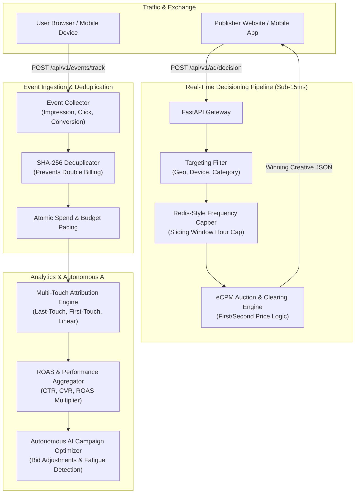

# Real-Time AdTech Decisioning & Attribution Platform

[](https://github.com/awanish5101/adtech-decisioning-attribution-platform/actions)
[](https://www.python.org/downloads/)
[](https://fastapi.tiangolo.com)
[](https://www.docker.com/)
[](https://opensource.org/licenses/MIT)

A high-throughput, low-latency AdTech decisioning and attribution engine built with Python 3.11 and FastAPI. Designed to power real-time ad serving decisioning calls within sub-15ms SLAs, ingest high-velocity impression/click/conversion event streams with atomic deduplication, calculate multi-touch ROAS (Return On Ad Spend) attribution metrics, and execute autonomous AI campaign optimization routines.

---

## Architecture & System Design



---

## Core Capabilities

1. **Sub-15ms Real-Time Ad Decisioning:**
   - Evaluates device types (`MOBILE`, `DESKTOP`, `TABLET`), geolocation ISO country codes, and IAB categories.
   - Filters floor pricing against campaign bid rates.
   - Executes dynamic eCPM auctions with first-price and second-price clearing logic.

2. **Redis-Style Sliding Window Frequency Capping:**
   - Enforces configurable hourly frequency caps per user and campaign (e.g., max 3 impressions per user per hour).
   - Eliminates banner fatigue and preserves advertiser budget pacing.

3. **High-Throughput Ingestion & Atomic Deduplication:**
   - Ingests high-velocity impression, click, and conversion event streams.
   - Employs SHA-256 payload hashing to deduplicate duplicate network events, eliminating fraudulent double-billing and skewed metrics.
   - Atomically updates real-time budget balances and transitions exhausted campaigns.

4. **Multi-Touch ROAS & Attribution Analytics:**
   - Implements **Last-Touch**, **First-Touch**, and **Linear** multi-touch attribution models over full user journey touchpoints.
   - Accurately tracks Click-Through Rate (CTR), Conversion Rate (CVR), and Return on Ad Spend (`ROAS = Revenue / Ad Spend`).

5. **Autonomous AI Campaign Optimization Agent:**
   - Continuously audits live campaign ROAS and CTR trajectories.
   - Autonomously generates recommended bid adjustments (e.g. increase bids by 15% for high-yield ROAS > 3.0x campaigns; curb bids by 20% for negative ROI campaigns).
   - Flags creative fatigue when low CTR patterns are detected.

---

## Project Structure

```text
adtech-decisioning-attribution-platform/
├── app/
│   ├── __init__.py
│   ├── main.py                  # FastAPI application entrypoint & middleware
│   ├── config.py                # Platform thresholds & SLA configuration
│   ├── api/
│   │   ├── decisioning.py       # POST /api/v1/ad/decision
│   │   ├── campaigns.py         # Campaign marketplace CRUD
│   │   ├── events.py            # POST /api/v1/events/track
│   │   ├── analytics.py         # GET /api/v1/analytics/roas
│   │   └── ai_agent.py          # POST /api/v1/ai/optimize-campaigns
│   ├── core/
│   │   ├── frequency_capper.py  # Sliding window frequency capping
│   │   ├── deduplicator.py      # Event deduplication engine
│   │   └── telemetry.py         # Request execution profiler
│   ├── models/
│   │   ├── campaign.py          # Campaign schemas & status
│   │   ├── ad_request.py        # Auction request & decision response
│   │   ├── event.py             # Tracking events & payloads
│   │   └── attribution.py       # ROAS report schemas & models
│   ├── services/
│   │   ├── decisioning_engine.py      # Real-time ad serving & eCPM ranking
│   │   ├── event_ingestion_service.py # Ingestion & budget ledger updates
│   │   ├── attribution_service.py     # Multi-touch attribution modeling
│   │   └── ai_optimization_agent.py   # Autonomous campaign optimization
│   └── storage/
│       └── repository.py        # Thread-safe in-memory datastore
├── tests/
│   ├── conftest.py              # Test harness & fixtures
│   ├── test_decisioning.py      # Real-time auction & latency tests
│   ├── test_frequency_capping.py# User frequency capping tests
│   ├── test_event_ingestion.py  # Ingestion & deduplication tests
│   ├── test_attribution_roas.py # Multi-touch attribution & ROAS tests
│   └── test_ai_agent.py         # AI optimization agent tests
├── .github/
│   └── workflows/
│       └── ci.yml               # GitHub Actions CI workflow
├── Dockerfile                   # Production container definition
├── docker-compose.yml           # Local composition configuration
├── pytest.ini                   # Pytest runner settings
└── requirements.txt             # Dependencies
```

---

## Quickstart & Local Setup

```bash
git clone https://github.com/awanish5101/adtech-decisioning-attribution-platform.git
cd adtech-decisioning-attribution-platform

python3 -m venv venv
source venv/bin/activate
pip install -r requirements.txt

# Run server
uvicorn app.main:app --reload --port 8080
```
Interactive API documentation is available at `http://localhost:8080/docs`.

---

## Automated Test Verification

Run the test suite with `pytest`:

```bash
pytest -v
```

Expected test outcomes:
```text
tests/test_decisioning.py::test_health_probes PASSED
tests/test_decisioning.py::test_successful_ad_decisioning PASSED
tests/test_decisioning.py::test_no_bid_floor_price_exceeded PASSED
tests/test_frequency_capping.py::test_frequency_capping_enforcement PASSED
tests/test_event_ingestion.py::test_impression_and_click_tracking PASSED
tests/test_event_ingestion.py::test_event_deduplication PASSED
tests/test_attribution_roas.py::test_roas_calculation_and_attribution PASSED
tests/test_ai_agent.py::test_ai_optimization_agent_recommendations PASSED
```

---

## Docker Deployment

```bash
docker build -t adtech-decisioning-attribution-platform .
docker run -p 8080:8080 adtech-decisioning-attribution-platform
```

---

## License
MIT
